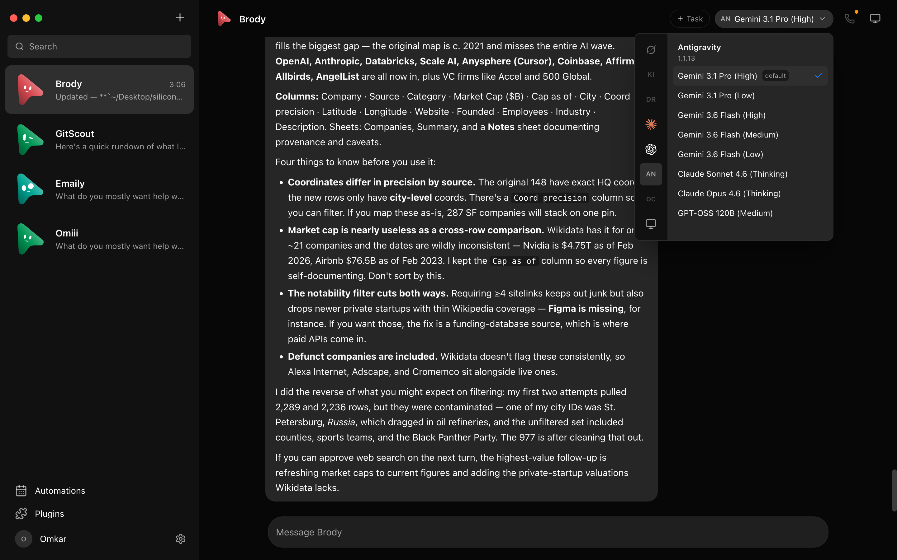
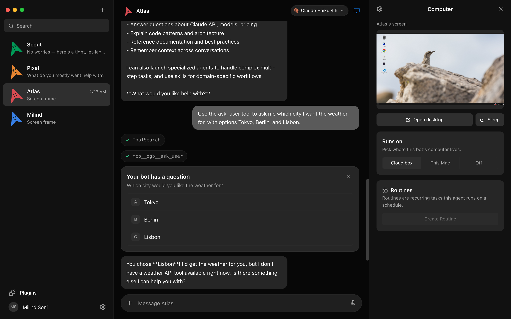
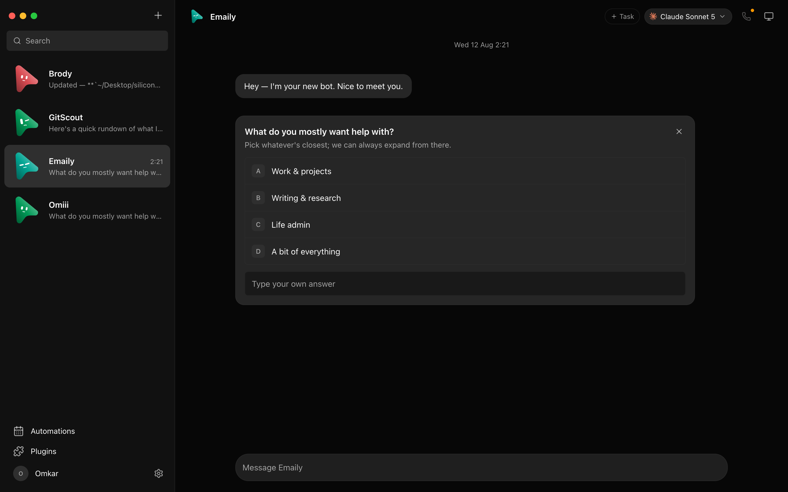
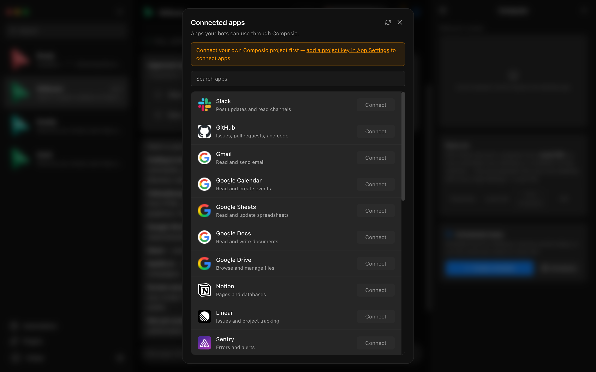
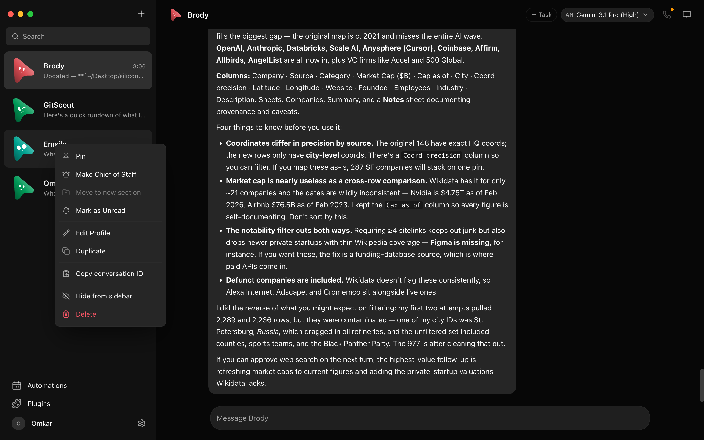
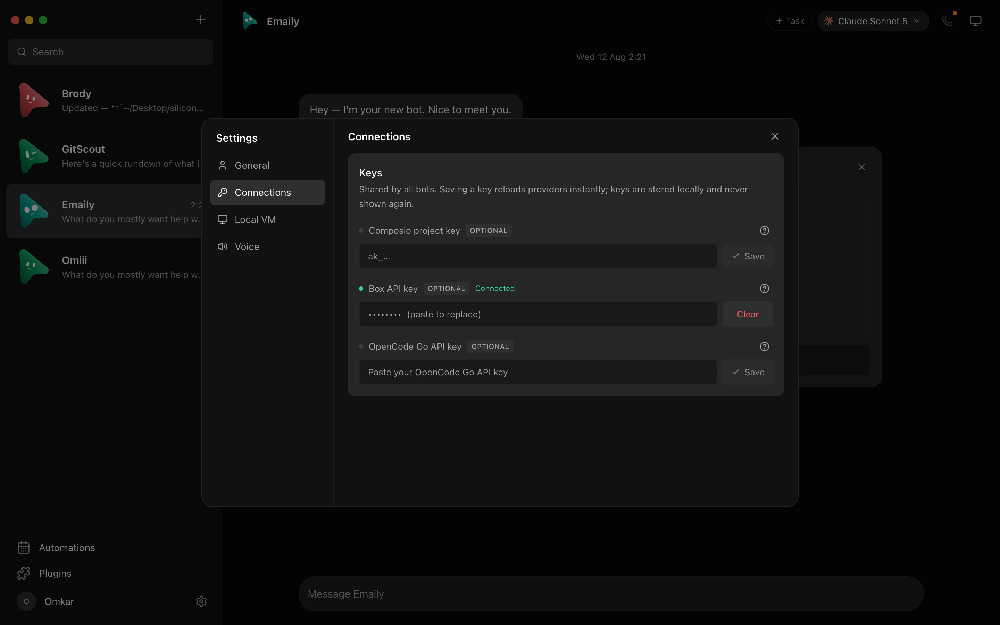
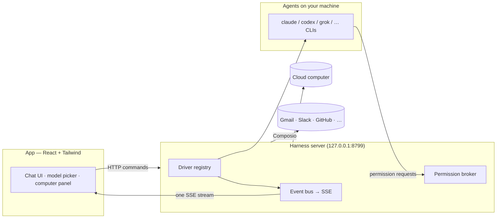

<div align="center">

# SpokyBot

**Your own team of AI agents, in a chat app — local-first, on the models you already have.**

[](https://github.com/xxspokiixx/SpokyBot/releases/latest)
[](https://github.com/xxspokiixx/SpokyBot/actions/workflows/android-apk.yml)
[](https://github.com/xxspokiixx/SpokyBot/actions/workflows/ci.yml)


<br>

<a href="https://github.com/xxspokiixx/SpokyBot/releases/latest/download/app-debug.apk">
  
</a>

<br>
<br>

<sub>SpokyBot is an independent, open-source fork of [OpenMausBot](https://github.com/milind-soni/OpenMausBot), rebranded and extended with a self-contained Android app. Not affiliated with xAI, Meta, OpenAI, Manus or the upstream authors.</sub>

</div>

---

Every bot in the sidebar is a real agent — Claude, Codex, Grok, Gemini, OpenCode and many more running under the hood — with its own personality, its own model, its own computer, and its own connected apps. Talk to them like contacts, watch them work, and approve what matters.

One small harness server on `127.0.0.1` owns every agent process. Transcripts, keys and events live in `~/.openmausbot` on your own machine (or entirely on your phone), not in a cloud. Bring the CLI logins and subscriptions you already have; there is no proxy in the middle.

## Platforms

| Platform | How to run | Status |
|---|---|---|
| **Android** | Prebuilt debug APK from [Releases](https://github.com/xxspokiixx/SpokyBot/releases/latest) — the whole server runs on-device | Published by CI on every push to `main` |
| **macOS** (Apple silicon & Intel) | `pnpm package:mac` → `.dmg` | Build from source |
| **Windows** (x64) | `pnpm package:win` → installer + zip | Build from source |
| **Ubuntu 24.04** (x64) | `pnpm package:linux` → `.deb` / AppImage | Beta, build from source |
| **Web / self-hosted** | `pnpm dev` or the bundled harness server | Supported |

## Features

<table>
<tr>
<td width="50%" valign="top">

### 🧠 Pick a brain per bot

A model picker with a provider rail. Switch a bot's model mid-conversation; unavailable providers are dimmed with the reason. **25 built-in engines** (see below) plus any OpenAI-compatible endpoint or custom ACP CLI.



</td>
<td width="50%" valign="top">

### 🖥️ Every bot gets a computer

Open the Computer panel and the bot's desktop spins up on its own — live screen preview while it works, take over in your browser, or point the bot at a cloud desktop, an isolated Local VM, your own computer, or a VPS you bring.



</td>
</tr>
<tr>
<td width="50%" valign="top">

### 🙋 Bots ask before they act

Shell commands, file edits and questions surface as inline cards — Allow / Deny / answer in chat. A permission broker turns every risky action into a decision you make, on cloud and local computers alike.



</td>
<td width="50%" valign="top">

### 🔌 Connected apps

A one-click marketplace over Composio: Gmail, Slack, GitHub, Notion, Linear and hundreds more. OAuth once, and every bot can use them as tools. On Android the OAuth flow opens in the system browser and returns to the app.



</td>
</tr>
<tr>
<td width="50%" valign="top">

### 🗂 Manage bots like chats

Right-click any bot: pin, mark unread, edit profile, duplicate, copy conversation ID, hide, delete. It's a messaging app — your agents behave like contacts.



</td>
<td width="50%" valign="top">

### 🔑 Keys once, everything lights up

Paste credentials in App Settings — they persist locally and the provider fleet hot-reloads instantly. Secrets are write-only: the UI only ever sees "configured" flags.



</td>
</tr>
</table>

### 🤖 Bring your own agents

Bots run on the CLIs installed on your own machine — your existing logins and subscriptions, no new accounts. Built-in drivers ([`server/drivers/builtIn.ts`](server/drivers/builtIn.ts)):

> Claude · Codex · Grok (CLI & ACP) · Gemini · Kimi · Droid · Cursor · OpenCode · Qwen · Hermes · Cline · Copilot · Antigravity · Pi · MiniMax · Mistral · Cerebras · Groq · Greenference · Meta · MuseCode · DeepSeek · any OpenAI-compatible endpoint · any custom ACP CLI

Point any engine at a custom CLI binary (a versioned build or wrapper) in **Settings → Engines**. Unknown drivers degrade to "unavailable" and never crash the fleet.

### #️⃣ Channels for every context

Keep Work, Personal and each project in separate channels without cloning your bots. Every channel has its own transcript, shared instructions, working folder, responder rules and editable bot roster.

### ⚡ Fast decisions

Add a TypeSafe Jev key, or an OpenRouter key and model, in **Settings → Decision model** and rooms set to **Auto** pick the bot that fits each un-mentioned message in a few hundred milliseconds, falling back to the room's lead when unsure. See [docs/decision-model.md](docs/decision-model.md).

### 📦 Install and share whole teams

- **Import** outcome-driven teams from a Markdown file, a public GitHub URL, or a Grok link. A review screen shows the bots, Chief of Staff, channels, playbooks, connector checklist and suggested routines before anything is created. Connections stay off until you approve them; routines arrive paused; packages never carry credentials or history.
- **Share** a whole department as one portable file — bots, instructions, pictures, skills, group chats, routines and connection slots — with secrets scrubbed. Importers get new bots on Ask, skills off and routines paused.
- **Presets** travel your "New bot" defaults; an **organization library** lets admins share packages with connected desktops.

See [docs/team-sharing.md](docs/team-sharing.md), [docs/presets.md](docs/presets.md) and [docs/org-library.md](docs/org-library.md).

### 🎧 Bots that talk back

Press the speaker on any reply, or switch a bot to read answers aloud as they land. Hit **call** and it's a conversation: it hears you, narrates what it's doing, and asks for approvals out loud. Choose ElevenLabs, Fish Audio, Grok (xAI), built-in macOS voices, or a local Chatterbox server; give each bot its own voice. Native on-device dictation is available on macOS.

### ⏰ Triggers: schedules and webhooks

Tell a bot "every weekday at 9, send me a summary of my inbox" or "whenever our form calls, draft a reply" and it sets the trigger up in that turn. **Triggers** lists every schedule and webhook with a calendar and run history. Webhook secrets are never shown to the bot. See [docs/routine-schedules.md](docs/routine-schedules.md) and [docs/proactive-routines.md](docs/proactive-routines.md).

### 🧰 Skills, memory and files

A bundled skills library, per-bot memory and journals, file attachments with previews, rich tables and charts, and transcript export. See [docs/memory.md](docs/memory.md) and [docs/files.md](docs/files.md).

### 💾 Encrypted workspace backups

Export the whole workspace as a password-encrypted `.ombbackup`, then restore it selectively by category (bots, groups, threads, messages, files, config, routines, webhooks). Credentials and external CLI sign-ins are never included. On Android the backup downloads straight to the phone.

### 🔌 Orchestrate over MCP, or from scripts

- A stdio **MCP server** exposes a bounded team control plane (inspect bots/channels, read transcripts, create and configure, send work, wait, switch models, interrupt) for clients like Claude Desktop and Cursor. It never exposes approvals, deletion, credentials or computer lifecycle. See [docs/mcp-server.md](docs/mcp-server.md).
- The headless **`openmausbot` CLI** drives a running workspace without a screen — apply a team file, give a bot one job, wait for completion, export the result, with `--json` and scriptable exit codes. See [docs/headless-cli.md](docs/headless-cli.md).

## 📱 The Android app

SpokyBot ships a self-contained Android app: the entire Node harness runs **on the phone** and the web UI is served from `http://127.0.0.1:8799` inside a full-screen WebView. No cloud, no store account, no companion PC required.

- **Embedded runtime** — a cross-compiled Node binary (`libnodeexec.so`) boots the bundled server; a foreground service extracts assets, starts the harness and pairs the WebView session automatically.
- **Local Linux desktop** — proot + an Alpine rootfs give bots an isolated Local VM on-device.
- **Native bridges** — file downloads and backups save to the phone; external/OAuth links open in the system browser; the microphone powers live calls; notifications and the camera (via a private `FileProvider`) work natively.
- **Deep links** — `openmausbot://` intents route to settings, package install and chats; Android's back gesture closes the open drawer/overlay before leaving the page.
- **Hardened boot** — real timeouts on rootfs extraction and the shell probe, with captured logs and a Retry screen instead of an endless spinner.

CI builds and publishes the debug APK to [Releases](https://github.com/xxspokiixx/SpokyBot/releases) on every push to `main` that touches the app. Architecture and boot states are documented in [`android-test/README.md`](android-test/README.md).

> ⚠️ **Building locally?** `android-test/prepare-android-assets.mjs` stages your `~/.ssh` keys into the APK for the BYO-VPS feature. A locally built APK therefore contains your private keys — keep it on your own device and **never redistribute it**. The staged keys are git-ignored so they are never committed.

## How it works

Two processes. The app holds no transports of its own — it sends typed commands over HTTP and folds one SSE event stream into state. The harness server owns every agent process and normalizes each provider's native protocol into one canonical runtime event stream.



| Layer | Where | What it does |
|---|---|---|
| Drivers | `server/drivers/` | One per provider; unknown drivers degrade to "unavailable". |
| Harness | `server/harness/` | Registry and the fan-in event bus every client folds. |
| API | `server/index.ts`, `server/routes/` | Bots, turns, approvals, models, computers, connectors, config — HTTP + SSE. |
| Voice | `server/tts/` | ElevenLabs, Fish Audio, Grok (xAI), macOS voices, local Chatterbox. |
| App | `src/` | The chat shell: server-backed store, one reducer, zero client-side transports. |
| Desktop | `electron/` | macOS/Windows/Ubuntu shells with an embedded harness and platform capabilities. |
| Android | `android-test/` | Kotlin shell hosting the same harness on-device. |

## Getting started

Requires **Node ≥ 24** and **pnpm 10**, plus at least one agent CLI (e.g. `claude`, `codex`, `grok`) installed and logged in — it appears in the model picker automatically.

```sh
git clone https://github.com/xxspokiixx/SpokyBot && cd SpokyBot
pnpm install
pnpm dev:server    # harness server → 127.0.0.1:8799
pnpm dev           # web UI → http://127.0.0.1:5199
pnpm dev:desktop   # Electron shell with the embedded harness
```

### Build & test

```sh
pnpm typecheck      # app + server
pnpm test           # unit, driver, API and desktop capability tests
pnpm lint           # oxlint
pnpm build          # typecheck + production web build
pnpm build:server   # self-contained server bundle (dist-server/)
```

### Package

```sh
pnpm package:mac    # macOS .dmg
pnpm package:win    # Windows installer + zip
pnpm package:linux  # Ubuntu x64 .deb + AppImage
pnpm build:android  # stage assets + assemble the debug APK
```

The Android build needs a JDK (17+) and the Android SDK; `android-test/local.properties` points at your SDK. The runtime binaries (`libnodeexec.so`, the Linux rootfs) are Git LFS objects — run `git lfs pull` before building so the APK ships real binaries instead of pointer stubs.

### Optional credentials

Local chat works without any of these. Paste a key once in **App Settings** to enable an integration:

| Credential | What it enables |
|---|---|
| Composio project key (`ak_…`) | Connect Gmail, GitHub, Slack, Notion and other apps ([docs/composio.md](docs/composio.md)) |
| Boat API key | Isolated remote Linux computers with a desktop and terminal |
| ElevenLabs / Fish Audio key | Read replies aloud and call your bots |
| Your own VPS (SSH) | Bring a persistent computer for your bots ([docs/byo-vps.md](docs/byo-vps.md)) |

Composio and Boat are third-party services with their own accounts and terms; cloud computers may incur charges.

## Continuous integration

| Workflow | Purpose |
|---|---|
| `android-apk.yml` | Build the debug APK and publish it to Releases on pushes to `main` |
| `ci.yml` | Typecheck, lint, vitest shards (Ubuntu/Windows/macOS), packaged-server and renderer smokes, OSS-edition build |
| `release.yml` / `prepare-release.yml` | Release gating and preparation |
| `package-win.yml` / `package-linux.yml` | Desktop packagers |
| `docker.yml` / `docs.yml` | Container image and documentation site |

## Privacy

Usage analytics are optional and anonymous: product events and a once-a-day count of what is set up, never keys, names, addresses or conversations. Turn them off in **Settings → General → Usage analytics**; [docs/analytics.md](docs/analytics.md) lists every event and property.

## License & attribution

SpokyBot is open source under the [Apache License 2.0](LICENSE), with one carve-out: everything under `enterprise/` is source-available under the [OpenMausBot Enterprise License](enterprise/LICENSE) and needs a license key for production use. Delete that folder and what remains is the open-source edition. See [LICENSING.md](LICENSING.md).

This project is a fork of **[OpenMausBot](https://github.com/milind-soni/OpenMausBot)** by Milind Soni and contributors. The OpenMausBot and MausBot names and mascot are trademarks of Supamaus Software Private Limited; the Apache License does not grant trademark rights, so this fork carries its own name. Bundled third-party software keeps its own licenses — see [NOTICE](NOTICE) and [`third_party/`](third_party/).